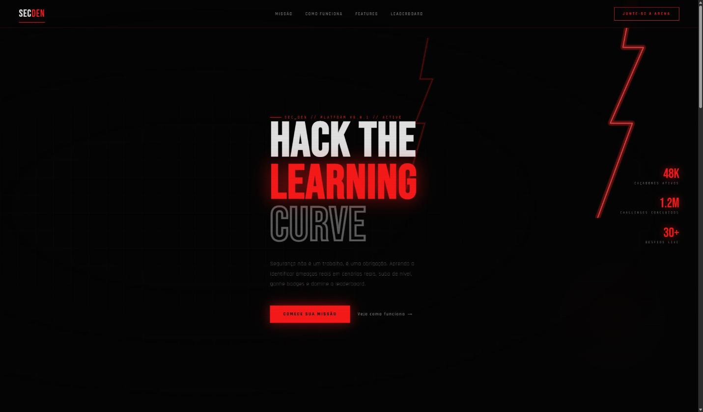
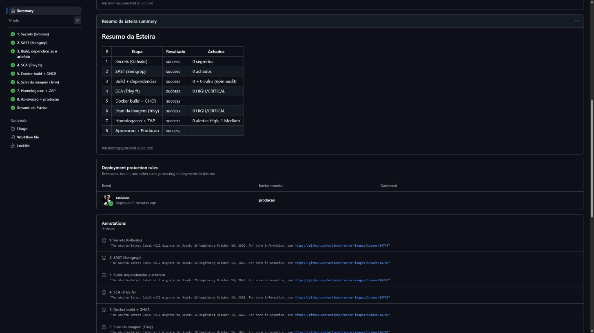
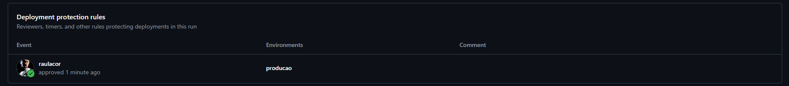

# SecDen


Plataforma gamificada de treino em ciberseguranca. Tem uma landing page e o Hub, onde o usuario faz desafios. O primeiro desafio ensina o que e forca bruta e mede o tempo de quebra de uma senha.

## Integrantes

| Nome                 | RM     |
| -------------------- | ------ |
| Raul Azzi Corsi      | 565112 |
| Lucas Cardoso        | 562689 |
| Vitor Yoshida        | 562026 |
| Fabricio Freitas     | 564782 |
| Kauê Monteiro Santos | 563248 |

## Producao

URL: https://challenge-fiap-2026-secden-sha256.onrender.com



## Como executar

Local (Node 22):

```bash
npm ci && npm ci --prefix hub
npm run build && npm run build --prefix hub
npm test
npx vite preview
```

Docker:

```bash
docker build -t secden .
docker run -p 8080:8080 secden
```

Acesse http://localhost:8080.

## Esteira

```
push (main)
  -> [1 Gitleaks] -> [2 Semgrep] -> [3 Build] -> [4 Trivy fs]
  -> [5 Docker + GHCR] -> [6 Trivy image] -> [7 Homologacao + ZAP]
  -> aprovacao humana -> [8 Producao]
  -> [Resumo da Esteira]
```

| #   | Etapa          | Ferramenta                    | Objetivo                                      | Gate                                |
| --- | -------------- | ----------------------------- | --------------------------------------------- | ----------------------------------- |
| 1   | Secrets        | Gitleaks                      | Nenhuma credencial no historico               | Bloqueia                            |
| 2   | SAST           | Semgrep                       | Falhas no codigo fonte                        | Bloqueia                            |
| 3   | Build          | npm                           | Build, testes, dependencias e artefato        | Bloqueia                            |
| 4   | SCA            | Trivy fs                      | CVEs e misconfig em dependencias e Dockerfile | Bloqueia HIGH/CRITICAL              |
| 5   | Imagem         | Docker + GHCR                 | Imagem com tag do SHA, assinada com Cosign    | Bloqueia                            |
| 6   | Scan da imagem | Trivy image                   | CVEs da imagem + SBOM                         | Bloqueia HIGH/CRITICAL com correcao |
| 7   | DAST           | ZAP Baseline e Full           | Falhas em execucao                            | Informativo                         |
| 8   | Producao       | Environment producao + Render | Deploy apos aprovacao                         | Aprovacao manual                    |

Relatorios da execucao mais recente: [Actions](https://github.com/raulacor/challenge-fiap-2026-SecDen/actions/workflows/devsecops.yml) (artifacts `relatorio-01` a `relatorio-08` e `resumo-da-esteira`).

Detalhes em [docs/pipeline.md](docs/pipeline.md). Achados em [docs/observacoes.md](docs/observacoes.md).

### Resumo da Esteira



### Aprovacao humana

O revisor consulta os relatorios das etapas 1 a 7 antes de aprovar.



| Execucao                                                                              | Aprovado por | Data       | Base da decisao                                                                        |
| ------------------------------------------------------------------------------------- | ------------ | ---------- | -------------------------------------------------------------------------------------- |
| [#3](https://github.com/raulacor/challenge-fiap-2026-SecDen/actions/runs/41326050353) | raulacor     | 01/11/2026 | 0 segredos, 0 achados Semgrep, 0 HIGH/CRITICAL nas etapas 4 e 6, 0 alertas High no ZAP |

### Etapa 4 x Etapa 6

A etapa 4 olha o codigo e as dependencias npm. A etapa 6 olha a imagem final, que tem so o nginx e o sistema base alpine. As dependencias npm ficam no estagio de build e nao vao para a imagem, entao os achados da etapa 6 vem do sistema base. Por isso a imagem usa `nginx-unprivileged` alpine e roda `apk upgrade` no build.

### Resumo e aprovacao

O Resumo depende da etapa 8, entao so aparece depois da aprovacao ou rejeicao. Optamos por nao criar um resumo parcial: os relatorios das etapas 1 a 7 ja ficam disponiveis como artifacts para o revisor.

### Stack

O projeto e Node.js, entao os comandos do Anexo A foram usados sem adaptacao. Sao dois apps Vite (landing na raiz e `hub/`), por isso o build roda `npm ci` e `npm run build` nos dois.
